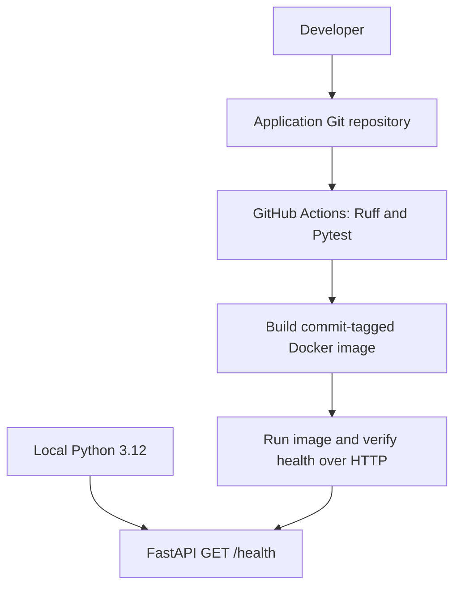
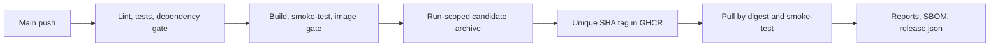
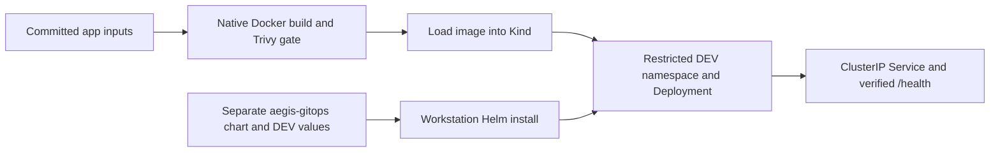
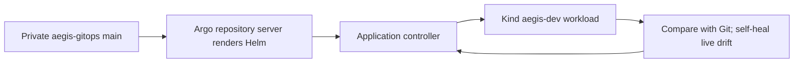
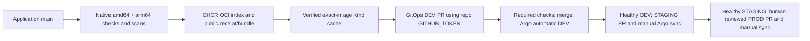

# Aegis CI/CD architecture

## Phase 1 foundation

The API returns HTTP 200 and `{"status":"ok"}`. It has no database or external
services; the health check confirms process responsiveness. A future dependency
readiness check should be distinct from liveness so an outage does not cause restart loops.

Lint and tests run before container work. The image contains runtime dependencies
and application code; tests and developer tools stay outside it. A two-stage build
copies a virtual environment into a slim runtime running as UID/GID 10001.

## Phase 2 release pipeline

PRs run CI without publication. Main runs Release, which calls CI and publishes
only after success. Only the publication job receives packages:write. It uses
GITHUB_TOKEN; no registry PAT is stored. The Docker base is digest-pinned Trixie.
The full policy and retained unsigned evidence are documented in DOCS/10 and DOCS/11.

## Phase 3 local bootstrap

Only DEV is installed. STAGING/PROD are schema-validated desired-state examples.
The local arm64 image has its own actual manifest digest; tracked environment values
reference the published Phase 2 amd64 GHCR digest. An isolated kubeconfig/context
keeps operations on the named local Kind cluster. This Phase 3 bootstrap applied Helm from the workstation. Phase 4 below
replaces ongoing manual deployment with Argo CD; CI never deploys application resources.

## Historical Phase 4 reconciliation

Argo uses a read-only repository deploy key, a scoped local project, and an automated
Application. The chart is rendered with DEV and tracked local native-image values.
Real Git scaling, live drift repair, and Git revert were verified. Manual workstation
Helm bootstrap is guarded after handoff. The original Helm release history is historical.

## Current Phase 5 release management

Both repositories are public following explicit approval and history credential scans.
Argo reads public HTTPS without a repository credential; the former SSH deploy key was
revoked. GHCR remains private. A workstation bridge verifies public release evidence,
imports an exact digest-preserving OCI bundle into the local Kind cache, and dispatches
the GitOps-owned proposal workflow. Background operation is pending explicit approval.

GitOps main, staging and prod are protected, including administrators. Required chart
and trusted-main promotion policy checks enforce source release validation, exact digest
reuse and fresh prior-environment health. Production requires an independent allowlisted
human approval at the current PR head. DEV reconciles automatically; STAGING/PROD
require explicit Argo sync. DEV and STAGING are verified; PROD PR #3 remains unapproved
and undeployed. All namespaces are in local Kind, with no AWS provisioning.

Health statuses are allowlisted operator observations with a 24-hour expiry, not signed
runtime attestations. Source release evidence is unsigned. CI has no cluster credentials.
See [the release guide](DOCS/20-release-management-guide.md) for code, commands and limits.
