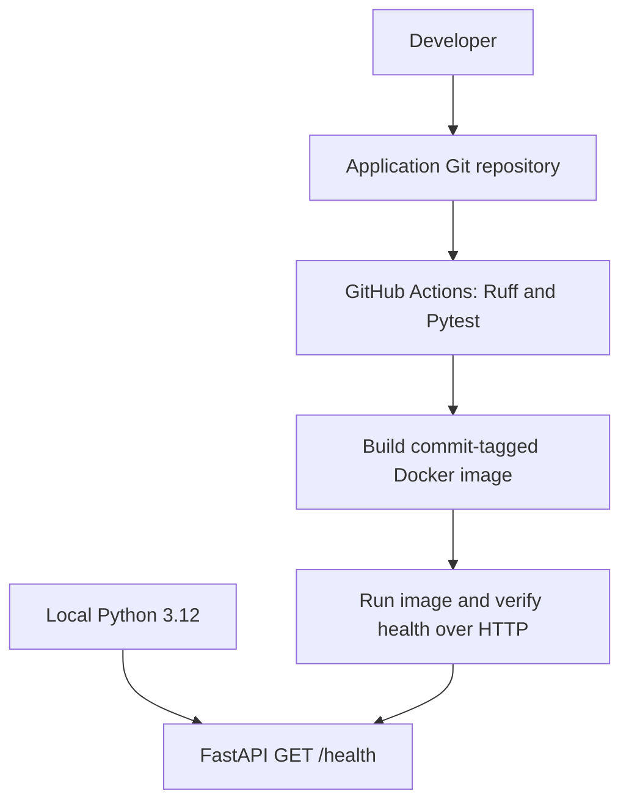
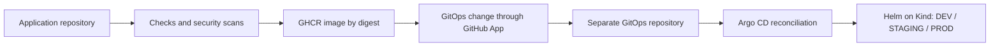

# Aegis CI/CD architecture

## Current implementation — Phase 1

The API returns HTTP 200 and `{"status":"ok"}`. It has no database or external
services; the health check confirms process responsiveness. A future dependency
readiness check should be distinct from liveness so an outage does not cause restart loops.

Lint and tests run before container work. The image contains runtime dependencies
and application code; tests and developer tools stay outside it. A two-stage build
copies a virtual environment into a slim runtime running as UID/GID 10001.

## Target architecture — later phases, not implemented

Use two repositories: `aegis-cicd` for application source and workflows, and
`aegis-gitops` for charts, environment values, and Argo CD Applications. Create the
second repository when its phase is approved. CI must never directly deploy application
resources with kubectl. Argo CD will own reconciliation. Image tags in Phase 1
identify CI commits but are not registry-enforced immutable references; digest-based
publication and evidence belong to Phase 2.

DEV will sync automatically; production desired-state changes will require reviewed
GitOps pull requests and protected branches. Reverting a GitOps commit will request
rollback through Argo CD. Git history links configuration changes to image digests.
Cross-repository updates should use a narrowly installed GitHub App with short-lived
tokens, not a long-lived personal access token.
