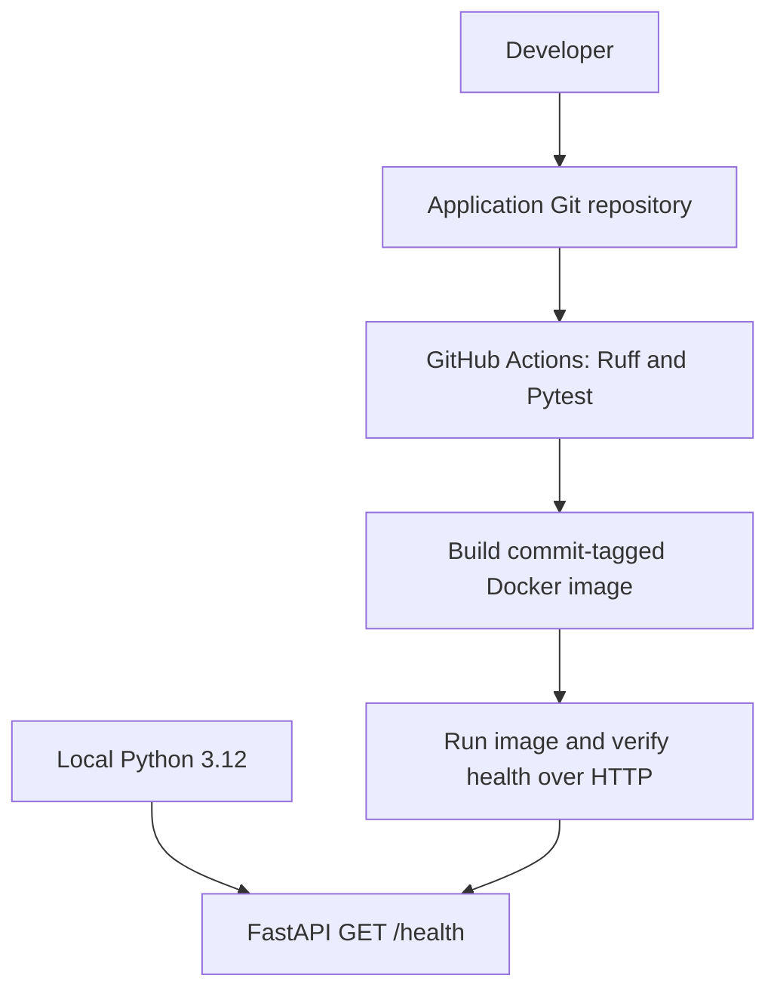
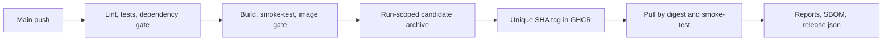
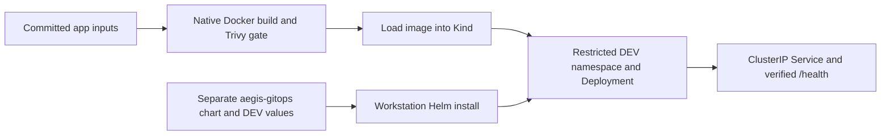
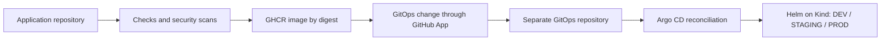

# Aegis CI/CD architecture

## Phase 1 foundation

The API returns HTTP 200 and `{"status":"ok"}`. It has no database or external
services; the health check confirms process responsiveness. A future dependency
readiness check should be distinct from liveness so an outage does not cause restart loops.

Lint and tests run before container work. The image contains runtime dependencies
and application code; tests and developer tools stay outside it. A two-stage build
copies a virtual environment into a slim runtime running as UID/GID 10001.

## Phase 2 release pipeline

PRs run CI without publication. Main runs Release, which calls CI and publishes
only after success. Only the publication job receives packages:write. It uses
GITHUB_TOKEN; no registry PAT is stored. The Docker base is digest-pinned Trixie.
The full policy and retained unsigned evidence are documented in DOCS/10 and DOCS/11.

## Current implementation — Phase 3 local deployment

Only DEV is installed. STAGING/PROD are schema-validated desired-state examples.
The local arm64 image has its own actual manifest digest; tracked environment values
reference the published Phase 2 amd64 GHCR digest. An isolated kubeconfig/context
keeps operations on the named local Kind cluster. Helm currently applies from the
workstation; no CI job deploys resources and Argo CD has not been installed.

## Target architecture — Phase 4 and later, not implemented

Use two repositories: `aegis-cicd` for application source and workflows, and
`aegis-gitops` for charts, environment values, and Argo CD Applications. The second repository is now implemented as a sibling checkout. CI must never directly deploy application
resources with kubectl. Argo CD will own reconciliation. Phase 2 publishes unique commit/run tags and records digest references.
Later deployment configuration must consume those digests.

DEV will sync automatically; production desired-state changes will require reviewed
GitOps pull requests and protected branches. Reverting a GitOps commit will request
rollback through Argo CD. Git history links configuration changes to image digests.
Cross-repository updates should use a narrowly installed GitHub App with short-lived
tokens, not a long-lived personal access token.
