# Phase 2 release and learning guide

## What changed and why

Phase 1 proved that code runs. Phase 2 also asks whether its dependencies and packaged
OS pass a security gate, then publishes the validated image to GHCR so another
system can retrieve the same content. Deployment is still a later phase.

```mermaid
flowchart LR
    Main[Push main] --> Quality[Ruff and Pytest]
    Quality --> Dependencies[Trivy dependency gate]
    Dependencies --> Build[Build and smoke-test candidate]
    Build --> Scan[Trivy image gate and SBOM]
    Scan --> Transfer[Validated image artifact]
    Transfer --> Publish[GHCR push]
    Publish --> Digest[Pull by digest and smoke-test]
    Digest --> Evidence[release.json and reports]
```



Pull requests run CI through the container gate and never publish. Main pushes run
Release, which calls CI using workflow_call. This small reuse prevents the release
path from skipping the same checks required on PRs; it is local to this project,
not the multi-team reusable platform planned for Phase 7. A manual Release run is
allowed on main only. The main push path runs validation once, rather than triggering
both independent CI and Release builds.

## Run locally

Install Trivy v0.76.1 using its [official installation guide](https://trivy.dev/docs/latest/getting-started/installation/).
Then, from the repository root:

```bash
bash scripts/verify-local.sh
bash scripts/scan-security.sh dependencies
docker build -t aegis-sample:phase2-local .
bash scripts/verify-container.sh aegis-sample:phase2-local
mkdir -p candidate
docker save -o candidate/image.tar aegis-sample:phase2-local
bash scripts/scan-security.sh image candidate/image.tar
```

The first scan needs network access for the vulnerability DB. Reports and candidate
archives are gitignored. A clean dependency scan does not imply a clean image scan:
OS libraries and pip installed in the base image are also inspected in the image.

## Run and inspect GitHub Release

Push a reviewed commit to main or use:

```bash
gh workflow run release.yml --repo prasanthece42/aegis-cicd --ref main
gh run list --repo prasanthece42/aegis-cicd --workflow release.yml
# Replace RUN_ID with the actual returned run ID:
gh run watch RUN_ID --repo prasanthece42/aegis-cicd --exit-status
gh run download RUN_ID --repo prasanthece42/aegis-cicd --pattern 'release-evidence-*' --dir /tmp/aegis-release-evidence
```

The run summary prints the digest reference. release.json records the commit, run,
platform, policy, image/config digests, and hashes of the reports and SBOM. Never
construct a digest from a Git commit: source hashes and image hashes name different
objects. The config digest identifies image configuration and uncompressed layers;
the registry manifest digest identifies the registry representation you pull.

The workflow publishes linux/amd64 because that is the GitHub runner platform.
On Apple Silicon, use `docker pull --platform linux/amd64 <digest-reference>` and
run with emulation if needed. Local builds remain native arm64. There is no tested
multi-platform release manifest yet.

## Failure handling

| Failure | Result / action |
| --- | --- |
| CRITICAL dependency | Stop before Docker build; inspect dependency-report artifact. |
| CRITICAL image package | Stop before export/publication; inspect image-reports and refresh dependencies/base digest. |
| Wrong source or scan identity | Stop before registry login; candidate metadata and scan must describe the same build. |
| GHCR denied | Check job packages:write, package ownership, repository linkage, and package Actions access; do not add a broad PAT. |
| No registry digest or wrong image after pull | Fail the release; do not deploy its tag. |
| HTTP failure after push | Job fails; partial evidence is retained. The already-pushed uniquely tagged image is not automatically deleted. |
| Scanner database download failure | Fail closed and retry after resolving connectivity. |

If a pre-existing GHCR package has the same name but different permissions, grant
this repository Actions access in package settings. First publication uses an OCI
source label to link the package to this repository. New GHCR packages are private
by default; this workflow never makes them public.

## Interview practice

| Question | Answer |
| --- | --- |
| Why scan dependencies and the image? | The lock scan sees developer/runtime Python dependencies; the image also contains OS libraries and packaging tools. |
| Why avoid rebuilding after scanning? | A rebuild can produce different bytes; transfer and publish the validated candidate. |
| Why deploy a digest? | A tag can be changed; a digest names exact registry content. |
| What is an SBOM? | An inventory of packaged components that supports vulnerability investigation and traceability. |
| Does a successful gate mean zero vulnerabilities? | No. It means the recorded scan met the documented policy at that time. |
| Why use GITHUB_TOKEN? | It is short-lived and scoped to the workflow repository/job; no long-lived registry password is stored. |
| Are evidence files signed provenance? | No. They record traceability but do not independently prove who produced them. |
