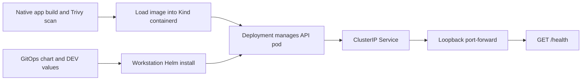

# Phase 3 — Kubernetes and Helm guide

## What we built

Kind runs a real Kubernetes control plane and worker processes inside local Docker
containers. Our one-node cluster is named aegis-dev. Helm turns a chart plus values
into Kubernetes resources and installs them. The chart lives in sibling aegis-gitops;
application source and local orchestration scripts remain in aegis-cicd.



This is a manually bootstrapped local deployment. GitHub CI validates code/charts;
it never deploys with kubectl. Helm does not continuously reconcile Git changes.
Argo CD is the next phase and will own that reconciliation when approved.

## Tools and repository setup

Use Docker Desktop, Python 3.12, Git, curl, rg, Kind 0.33.0, kubectl 1.35.8,
Helm 4.2.4, kubeconform 0.8.0, and Trivy 0.76.1. The missing binaries were installed
with official release checksum verification in `/tmp/aegis-phase3-bin`; Trivy is in
`/tmp/aegis-phase2-bin`. These temporary tools may be removed by the OS. For a durable
setup, install the same versions on your PATH using their official guides.

- [Kind installation](https://kind.sigs.k8s.io/docs/user/quick-start/)
- [kubectl installation](https://kubernetes.io/docs/tasks/tools/)
- [Helm installation](https://helm.sh/docs/intro/install/)
- [kubeconform releases](https://github.com/yannh/kubeconform/releases)

Keep the two checkouts side by side:

```text
aegis-cicd/       Application, release pipeline, Kind config and local scripts
aegis-gitops/     Helm chart, environment namespaces/values, static chart CI
```

If your GitOps checkout is elsewhere, set AEGIS_GITOPS_DIR to its absolute path.
No credentials or .local files should be committed to either repository.

## Bootstrap DEV

From aegis-cicd:

```bash
export PATH="/tmp/aegis-phase3-bin:/tmp/aegis-phase2-bin:$PATH"
export TRIVY_CACHE_DIR=/tmp/aegis-trivy-cache
bash scripts/bootstrap-local.sh
bash scripts/bootstrap-local-k8s.sh
```

The script checks tools, runs app/chart checks, requires committed image inputs,
builds a native image, applies the Phase 2 CRITICAL security gate, creates/reuses Kind,
loads the image, resolves its actual containerd manifest digest, and generates
`.local/kind-values.yaml`. It creates only the DEV namespace, performs server-side
dry-run validation, installs/upgrades with Helm, and checks the endpoint.

The dedicated kubeconfig is `.local/kubeconfig`; every Kubernetes/Helm operation
specifies that file and kind-aegis-dev explicitly. The scripts also require a loopback
API server and the expected Kind Docker-node label. Your existing AWS context is
not selected or modified. Do not export KUBECONFIG with this workspace path: its
colon would be treated as a path-list separator. Use explicit --kubeconfig flags.

## Inspect and access the running API

From aegis-cicd, using the tool PATH above:

```bash
kubectl --kubeconfig .local/kubeconfig --context kind-aegis-dev get nodes
kubectl --kubeconfig .local/kubeconfig --context kind-aegis-dev -n aegis-dev get deployments,pods,services
bash scripts/verify-local-k8s.sh
kubectl --kubeconfig .local/kubeconfig --context kind-aegis-dev -n aegis-dev port-forward service/sample-api 18080:80 --address 127.0.0.1
```

Keep the last command running; in a second terminal:

```bash
curl --fail http://127.0.0.1:18080/health
# {"status":"ok"}
```

The verification script starts and cleans up its own temporary port-forward. To use
a different port for that check, set AEGIS_LOCAL_PORT. The cluster stays running for
inspection. To exercise replacement of the single disposable DEV pod:

```bash
bash scripts/verify-kind-recovery.sh
```

That test deliberately deletes the API pod in this local namespace, waits for its
replacement, compares identities/image references, and checks HTTP again. A single
replica can be briefly unavailable during deletion; this is not a high-availability test.

To remove only this named local cluster when finished:

```bash
bash scripts/teardown-local-k8s.sh
```

## Important files and code

| File | How it works |
| --- | --- |
| kind/cluster.yaml | Pins a one-node Kubernetes 1.35.8 cluster to a verified Kind node-image digest; API binds to loopback. |
| scripts/kind-common.sh | Defines explicit local kubeconfig/context commands and rejects nonlocal or wrong-node targets. |
| scripts/bootstrap-local-k8s.sh | Builds/scans a native candidate, loads it, generates a local digest override, and installs DEV. |
| scripts/verify-local-k8s.sh | Checks rollout, live security/resources/probes/digest, UID 10001, and actual Service HTTP. |
| scripts/verify-kind-recovery.sh | Verifies ReplicaSet replacement after deleting the owned DEV pod. |
| scripts/teardown-local-k8s.sh | Deletes the dedicated Kind cluster after local identity checks. |
| GitOps Chart.yaml | Names and versions the Helm application chart. |
| GitOps values.yaml | Provides repository/digest, replica, Service, and resource defaults. |
| GitOps values.schema.json | Rejects missing/malformed digests, invalid replica counts, and malformed resource quantities. |
| GitOps templates/deployment.yaml | Builds the Pod template, digest reference, rolling strategy, probes, resources, and fixed security settings. |
| GitOps templates/service.yaml | Routes port 80 to the selected ready pods' named http port 8000. |
| GitOps templates/serviceaccount.yaml | Provides a workload identity with automatic API-token mounting disabled. |
| GitOps environments/* | Namespace policy plus explicit image digest and per-environment replicas/resources. |
| GitOps scripts/validate-chart.sh | Lints/renders all environments, validates Kubernetes schemas, and rejects invalid inputs. |
| GitOps .github/workflows/validate.yml | Runs static chart checks on GitHub with checksum-verified tools and no deployment credentials. |

Helm's `{{ .Values.image.digest }}` reads a value. `{{ .Release.Namespace }}` reads
the target namespace. `include` reuses label/name helpers; `nindent` indents generated
YAML. A JSON schema validates inputs before a malformed deployment reaches Kubernetes.

## Image and registry boundary

Tracked environment files reference the verified Phase 2 private GHCR release, which
is linux/amd64. The native local profile builds linux/arm64 from committed app inputs,
scans it, loads it into Kind, and uses a different local manifest digest with
imagePullPolicy Never. The generated override is outside tracked desired state.
There is no long-lived GHCR token in Kubernetes and no private GHCR pull was verified.
A missing cached local image fails rather than falling back to an unapproved remote.

Direct registry deployment later requires a pullable architecture and registry
credentials/credential-provider configuration. imagePullSecrets accepts existing
Secret names, but no token or registry Secret is created here. Do not claim the
local arm64 image is the published amd64 digest.

## Failure handling and interview practice

| Symptom/question | Explanation or action |
| --- | --- |
| Pending pod | Inspect describe pod and namespace events for scheduling/resource constraints. |
| ErrImageNeverPull | Rerun bootstrap to reload the digest-matched local image; confirm the correct Kind cluster. |
| ImagePullBackOff with tracked values | Check private registry permissions, Secret names, architecture, and the exact digest. |
| CrashLoopBackOff | Inspect container logs and previous logs; check memory limits, startup, and write permissions. |
| Not Ready | Read probe events and test /health; a running process alone is insufficient. |
| Helm timeout | Inspect deployment/pod/events. A later upgrade requests rollback to a prior successful release; first install has no successful predecessor. |
| Port-forward exits | Confirm deployment readiness and choose a free loopback port. |
| Namespace versus cluster | A namespace groups API resources within the same cluster; it is not a separate control plane or a network-isolation guarantee. |
| Deployment versus Pod | Deployment/ReplicaSet controllers maintain the requested pod count; a bare Pod has no replacement controller. |
| Readiness versus liveness | Readiness controls traffic eligibility; liveness can restart a stuck container. Startup delays both until initialization succeeds. |
| Why requests and limits? | Requests influence scheduling; limits bound consumption. Memory-limit violations can kill a container. |
| What does Helm add? | Parameterized, versioned resource templates and release history; continuous Git reconciliation comes from Argo CD later. |

For diagnosis, keep explicit context flags:

```bash
kubectl --kubeconfig .local/kubeconfig --context kind-aegis-dev -n aegis-dev describe deployment sample-api
kubectl --kubeconfig .local/kubeconfig --context kind-aegis-dev -n aegis-dev logs deployment/sample-api
kubectl --kubeconfig .local/kubeconfig --context kind-aegis-dev -n aegis-dev get events --sort-by=.lastTimestamp
```
