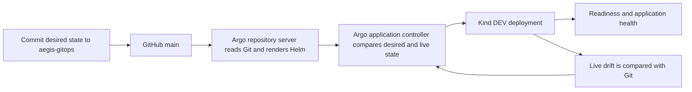

# Phase 4 — Argo CD guide and code walkthrough

## The flow that now works



We demonstrated: Git replicaCount 1 -> 2; live kubectl change 2 -> 3; Argo self-heal
3 -> Git's 2; git revert -> 1. No workstation Helm deployment, manual Argo sync,
manual refresh, or webhook was used for these updates. Argo polled the private repo.
GitHub CI validates changes; Argo, inside the cluster, performs reconciliation.

The separate source pipeline still builds/scans/publishes images to GHCR. It does
not yet update the GitOps image digest automatically. This phase connects GitOps
changes to Kubernetes; it does not claim a fully connected source-to-production flow.

## Bootstrap from the workstation

Prerequisites: the Phase 3 Kind cluster, native image cache, sibling GitOps checkout,
working GitHub CLI authentication with permission to manage that repository's deploy
keys, curl, Python 3, ssh-keygen, and kubectl. Missing image cache requires a deliberate
rebuild/load and Git digest update; never label a different image with the old digest.

From aegis-cicd:

```bash
export PATH="/tmp/aegis-phase3-bin:$PATH"
bash scripts/install-local-argocd.sh
bash scripts/register-argocd-repository.sh
bash scripts/connect-local-argocd.sh
bash scripts/verify-local-argocd.sh
```

The install script verifies the upstream manifest's SHA256 against
config/argocd-version.json, then applies it to the explicit local kubeconfig/context.
It creates Argo's namespace/CRDs/controllers and configures annotation tracking and
polling. The default project has no source/destination access.

The registration script generates/reuses an SSH key and registers only its public
half as a read-only deploy key on prasanthece42/aegis-gitops. It never copies your
GitHub account token to Kubernetes. Connection creates a repository Secret from the
private-key file using a pipeline that prints only the Secret's resource name, then
applies the restricted AppProject and Application. SSH host checking uses the pinned
upstream known-hosts ConfigMap; insecure SSH options are not enabled.

The project/Application root definitions are bootstrapped by the workstation. They
are not an app-of-apps root that manages itself. The chart and local values are the
workload source that Argo continuously watches.

## Read status and open the UI

```bash
kubectl --kubeconfig .local/kubeconfig --context kind-aegis-dev -n argocd get applications
bash scripts/verify-local-argocd.sh
bash scripts/port-forward-argocd.sh
```

The last command stays running. Open https://127.0.0.1:8443. The local Argo server
uses a self-signed certificate. No ingress or public endpoint was created. Server
/healthz was verified over a temporary loopback HTTPS forward; a browser login was
not performed by the agent.

To retrieve your own initial local admin password when logging in, run locally:

```bash
kubectl --kubeconfig .local/kubeconfig --context kind-aegis-dev -n argocd get secret argocd-initial-admin-secret -o jsonpath='{.data.password}' | base64 --decode
```

Username is admin. Do not commit or share that password. The agent did not read or
print it. If you change the initial password, use your chosen password thereafter.

To reach the application, the Phase 3 Service port-forward commands still work.
Verification starts and cleans up a temporary application port-forward itself.

## Major code and configuration

| File | What it does |
| --- | --- |
| config/argocd-version.json | Pins release v3.5.6, source commit, and installation manifest hash. |
| scripts/install-local-argocd.sh | Downloads/checks/applies upstream installation, configures tracking/polling, waits for core controllers. Uses curl's system certificate trust. |
| scripts/register-argocd-repository.sh | Creates/reuses a repository-specific read-only SSH deploy key and records its nonsecret ID for later revocation. |
| scripts/connect-local-argocd.sh | Creates a scoped repository Secret from the private key without logging it; applies project/Application and checks readiness. |
| scripts/verify-local-argocd.sh | Polls Application status and live Deployment until revision/replicas/availability agree, then verifies UID/security/HTTP. |
| scripts/verify-gitops-flow.sh | Commits/pushes a local replica change, injects live drift, observes self-healing, and pushes a Git revert. It deliberately changes Git and local DEV. |
| scripts/port-forward-argocd.sh | Opens loopback-only access to the Argo server using the isolated context. |
| scripts/bootstrap-local-k8s.sh | Now refuses to overwrite the Argo-managed Application with a manual Helm install. |
| GitOps environments/local/values.yaml | Tracks native image digest and replica count as actual desired state in Git. |
| GitOps argocd/projects/aegis-local.yaml | Restricts this app to one repo, the in-cluster API, aegis-dev, Namespace and required workload kinds. |
| GitOps argocd/applications/sample-api-local.yaml | Defines chart path, values, release name, destination, automatic sync/prune/self-heal, retries, and namespace policy. |
| GitOps argocd/config/argocd-cm.yaml | Uses annotation ownership tracking and 30-second polling plus up to 5 seconds jitter. |

In the Application, `repoURL` is where desired state lives; `targetRevision: main`
chooses the branch; `path` chooses the chart. valueFiles are relative to the chart,
so ../../environments/local/values.yaml reads the local overlay. The later values
file overrides earlier values. `helm.releaseName: sample-api` preserves resource names.
Argo runs Helm rendering, not helm upgrade; old Phase 3 Helm history is historical.

`automated` enables Git-driven synchronization. `selfHeal` also repairs live changes
without a Git commit. `prune` permits deleting tracked workload resources removed
from desired state; allowEmpty=false prevents an accidentally empty app. These are
separate controls. Only the local DEV application has been installed in this phase.

Annotation tracking avoids replacing Helm's app.kubernetes.io/instance labels with
the Argo Application name, preserving Service selectors during adoption.

## Reproduce the real Git demonstration

From a clean GitOps main checkout with local replicaCount 1:

```bash
bash scripts/verify-gitops-flow.sh
```

This makes two real Git commits: one changing the local replica count to two, then
its revert to one. It waits for the exact pushed revision at each stage and verifies
HTTP after every change. Between commits it scales the live Deployment to three
and waits for Argo to restore Git's two. Reports are written under ignored reports/.

A failed demonstration may leave its last Git change active. Inspect Git history and
Argo status; revert only the demonstration commit if cleanup is needed. Never reset
or overwrite unrelated work. The script requires a clean GitOps main checkout.

## Credential lifecycle and limitations

The deploy key is a persistent, read-only local-development credential. Its private
half is in .local/argocd-gitops-readonly (mode 600) and the local repository Secret.
.local is ignored by Git. The nonsecret repository/key ID is in
.local/argocd-deploy-key.json. Deleting Kind does not revoke the GitHub key.
When retiring the integration, inspect that ID and revoke exactly that key:

```bash
python3 -m json.tool .local/argocd-deploy-key.json
# Replace KEY_ID with the recorded numeric ID:
gh api --method DELETE repos/prasanthece42/aegis-gitops/keys/KEY_ID
```

Use a GitHub App with short-lived installation tokens for a later managed repository
credential lifecycle. No long-lived PAT is stored here. The upstream non-HA Argo
controller has cluster-level permissions; the AppProject constrains this application,
not the controller's entire RBAC. GitHub branch protection, multi-user SSO, production
approvals, registry pull credentials, and HA are not configured by this local phase.

## Troubleshooting and interview questions

| Question/symptom | Explanation or action |
| --- | --- |
| Synced versus Healthy | Synced means live configuration matches Git; Healthy means resource health checks pass. Both matter. |
| OutOfSync | Compare Git desired state with live state. It can occur during drift or before a new revision is applied. |
| ComparisonError / Permission denied (publickey) | Check read-only deploy-key registration, repository Secret metadata, repo URL, and repo-server logs without dumping Secrets. |
| Missing values file | Ensure the file is committed/pushed and its path is relative to the chart. |
| ErrImageNeverPull | The native digest is absent from Kind. Load the correct image or commit a deliberate rebuilt-image reference. |
| InvalidSpecError | Inspect the project source, namespace, server, and allowed resource kinds; do not bypass project restrictions. |
| Why does a manual scale disappear? | selfHeal restores Git's declared replica count. Change Git for a durable change. |
| Why not helm rollback? | Argo will restore Git desired state. Revert the Git configuration and let Argo reconcile. |
| Git revert versus release rollback | This demonstration reverts replica configuration; it does not claim a failed-image production rollback exercise. |
| Does GitHub Actions need cluster credentials? | No. Argo pulls desired state and applies it inside the cluster. |

References: [official getting started](https://argo-cd.readthedocs.io/en/stable/getting_started/),
[private repositories](https://argo-cd.readthedocs.io/en/stable/user-guide/private-repositories/),
[automatic sync](https://argo-cd.readthedocs.io/en/stable/user-guide/auto_sync/),
and [project boundaries](https://argo-cd.readthedocs.io/en/stable/user-guide/projects/).
