# Phase 5 — Release management and promotion guide

## The complete local delivery path

```mermaid
flowchart LR
    Code[Application main] --> CI[Test and scan amd64 + arm64]
    CI --> Registry[GHCR OCI index + public release receipt/bundle]
    Registry --> Cache[Workstation verifies and imports exact content into Kind]
    Cache --> Proposal[GitOps workflow opens DEV PR with its own GITHUB_TOKEN]
    Proposal --> Checks[Required chart and release-policy checks]
    Checks --> DEV[Merge main; Argo auto-syncs DEV]
    DEV --> StagePR[Healthy DEV evidence permits STAGING PR]
    StagePR --> STAGE[Merge staging; operator asks Argo to sync]
    STAGE --> ProdPR[Healthy STAGING evidence permits PROD PR]
    ProdPR --> Review[Fresh independent human review + checks]
    Review --> PROD[Merge prod; operator asks Argo to sync]
```



The application and GitOps repositories are public with explicit user approval.
Full history scans with Gitleaks found no detected credentials before visibility
changed. GHCR remains private. An exact OCI bundle transfers the validated registry
content to this local cluster; no persistent registry PAT is installed in Kubernetes.
This is a local transport bridge, not a replacement for real cluster registry access.

## Same image, different environment configuration

| Environment | Git branch | Namespace | Reconciliation |
| --- | --- | --- | --- |
| DEV | main | aegis-dev | Argo automatic sync/self-heal after PR checks and merge |
| STAGING | staging | aegis-staging | Checked PR, then explicit Argo sync |
| PROD | prod | aegis-prod | Fresh human-approved PR, then explicit Argo sync |

A promotion copies the same immutable OCI index digest. It does not rebuild an image.
The index selects amd64 or arm64 for the node, and both child images were tested and
scanned before publication. Replica/resource differences remain environment-specific.
The branches share the initial chart/automation baseline; later chart/workflow changes
also require deliberate branch PRs, including production review.

Source release receipts are in public GitHub Releases. GitOps commits a canonical copy
under releases/catalog and an environment release.json pointer recording the prior
environment and exact Git revision. Policy validates these against the actual successful
source workflow and release asset, rather than trusting a PR's claimed digest alone.

## Approval and health controls

Application main requires PRs and the lint/test/dependency and amd64 container checks,
including administrators, with strict current checks and no force-push/deletion. Its
single-maintainer PRs need no second reviewer.

All GitOps branches require PRs and successful chart/promotion-policy checks, including
administrators. Force-push and deletion are disabled. CODEOWNERS adds review requirements
for chart, workflow, policy and tooling changes. PROD additionally requires one fresh
review, dismissal of stale reviews, and approval of the last push by another actor.
The policy accepts only an allowlisted human reviewer, not the PR author or a bot, at
the exact PR head SHA. Pending approval is a deliberate failed policy check, not a bypass.

Workstation health observations inspect Argo's Synced/Healthy status at the exact branch
HEAD, available replicas, and real Service HTTP. GitHub attributes the status to the
operator. Promotion requires that allowlisted operator, matching digest, and evidence
less than 24 hours old. A later failure supersedes an earlier success. These are
operator observations, not cryptographically signed runtime attestations.

The GITHUB_TOKEN is limited to the workflow repository. The GitOps workflow reads public
source release data and writes its own branches/PRs, then explicitly dispatches checks.
No account PAT or cross-repository write credential is stored in CI. GitHub can require
execution approval for bot-triggered PR workflows; approve only a known same-repo
validation run after checking its changed paths. This approval is separate from—and
does not satisfy—PROD's human PR approval.

## Local commands

From aegis-cicd, install/bootstrap prerequisites from earlier guides and use:

```bash
export PATH="/tmp/aegis-phase3-bin:$PATH"
# Replace RELEASE_TAG with a completed versioned release, such as release-40259693000-1:
python3.12 scripts/load_release_bundle.py RELEASE_TAG
python3.12 scripts/environment_delivery.py observe dev --wait
```

The loader verifies the source run, bundle hash, and imported index digest. It normalizes
only the OCI transport wrapper name to a unique fully qualified name; registry manifest
and layer/configuration blobs remain unchanged. It records a source commit cache status.

For one-shot automatic selection of the latest completed release:

```bash
python3.12 -m scripts.watch_local_delivery --once
```

The bridge imports a new release, dispatches its DEV proposal, and observes DEV health.
A later cycle observes a newly merged DEV revision after its PR checks complete. To keep
polling in a foreground terminal, after explicitly approving ongoing side effects:

```bash
python3.12 -u -m scripts.watch_local_delivery
```

The bridge uses your existing workstation GitHub login; it does not write that credential
to CI or Argo. It checks every 30 seconds, refreshes cache/health observations after 12
hours, and fails closed on download, validation, import, or health failures. Background
startup was separately approved and the bridge is running. Stop a foreground bridge with Ctrl-C. If started
with a recorded PID, inspect .local/delivery-watch.pid and terminate only that process.

Recreating Kind clears its image store: bootstrap Argo again and rerun the loader. Local
transport and observation are prerequisites; if the bridge is stopped, new uncached
releases intentionally fail the DEV proposal gate rather than deploying missing content.

Propose STAGING or PROD after observing the prior environment:

```bash
gh workflow run promote.yml --repo prasanthece42/aegis-gitops --ref main -f environment=staging
# After checked STAGING PR merge:
python3.12 scripts/environment_delivery.py sync staging
# This records healthy STAGING and its exact revision, permitting a PROD proposal:
gh workflow run promote.yml --repo prasanthece42/aegis-gitops --ref main -f environment=prod
```

Review the PROD PR in GitHub. Approval must be at its current head. After approval,
rerun validation if the policy check is still waiting, merge normally without --admin,
then run:

```bash
python3.12 scripts/environment_delivery.py sync prod
```

The sync helper refuses PROD without the enforced review protections and an independently
approved merged PR at that branch revision. It sends an Argo Application operation with
the configured sync options; Argo creates namespaces/applies workloads. CI never receives
cluster credentials and never runs application deployment kubectl commands.

## Code map

| File | Purpose |
| --- | --- |
| App .github/workflows/ci.yml | Native amd64/arm64 image matrix, tests, scans, candidate artifacts. |
| App .github/workflows/release.yml | Publish tested OCI platform manifests, verify pulls, create index and exact bundle/receipt. |
| App scripts/oci_manifest.py | Changes descriptor media types while preserving scanned configuration/layer blobs, including Docker health configuration. |
| App scripts/release_index.py | Validates both platform receipts and archived registry index before release publication. |
| App scripts/load_release_bundle.py | Verifies and imports exact registry content; records the cache observation. |
| App scripts/environment_delivery.py | Manual Argo sync and measured environment health observations. |
| App scripts/watch_local_delivery.py | Optional local loop connecting new releases/cache preparation to DEV PR dispatch and health. |
| App scripts/configure-release-protection.py | Installs actual GitHub protected-branch and review controls. |
| GitOps scripts/promotion.py | Source receipt verification, digest-preserving PR creation, prior-health checks and human approval policy. |
| GitOps policies/release.json | Allowed repositories, branch mapping, health observers/reviewers and expiry. |
| GitOps .github/workflows/promote.yml | Scheduled DEV proposal or explicit environment promotion using a repo-scoped token. |
| GitOps .github/workflows/validate.yml | Chart schemas, policy unit tests, trusted-main policy checks for PR metadata. |
| GitOps environments/*/release.json | Chosen release and prior-environment revision for traceability. |
| GitOps argocd/applications/* | Branch-specific automated DEV and manual STAGING/PROD policies. |

## Failure, drift and rollback

The DEV drill lowered memory to a 4Mi request and 8Mi limit. Static YAML/schema checks
accepted these valid quantities, but a real new pod was OOMKilled. The prior ready
replica still answered HTTP because the rolling policy keeps maxUnavailable at zero.
That observation is not a claim of continuous zero downtime. The environment health
check failed, and promotion was tested against that failed revision.

Rollback restores the known-good configuration through a Git revert PR with required
checks. Argo reconciles the merged revert; do not use helm rollback against an Argo-owned
workload. The image remains the same validated digest during this configuration-failure
exercise. It is a real failed rollout/configuration rollback, not a simulated pipeline
or a claim of testing a broken production image.

DEV self-heals live drift. STAGING/PROD report drift and require an approved/manual
reconciliation; the observer refuses to record healthy status for an OutOfSync app.
The existing Phase 4 direct-push demonstration is guarded once protected branches exist.

## Troubleshooting and interview questions

| Question/symptom | Explanation/action |
| --- | --- |
| Why promote a digest rather than rebuild? | A rebuild can change bytes; reuse the exact validated image across environments. |
| Why was OCI conversion rejected? | Converting format can change manifests or configuration. We preserve config/layer blobs and verify every published digest. |
| Missing cache health | Run the exact bundle loader for the completed release; do not forge a status or turn off the gate. |
| Failed/stale prior health | Inspect Argo/runtime, restore Git desired state if necessary, then record fresh real health. |
| PROD policy red after chart passes | Human approval is missing, withdrawn, self-authored, from a bot, or tied to an older head. After a fresh review, rerun any original failed PR check as well as dispatching fresh validation; GitHub may retain both suites. |
| Bot PR says action required | Review its diff and approve CI execution if it is the known validation run. This is not PROD approval. |
| Manual sync says namespace missing | Carry the Application's syncOptions, including CreateNamespace, in the manual Argo operation. |
| Argo Synced but not Healthy | Git may have applied successfully while the application is crashing or failing probes. Promotion must remain blocked. |
| Why three branches here? | GitHub can enforce a distinct production review boundary; each branch has its own desired state and Argo policy. |
| Does this provision cloud production? | No. All three namespaces are in the isolated local Kind lab. AWS remains a later explicitly authorized phase. |

Production multi-user SSO, cluster RBAC hardening, real node registry credentials,
signed runtime attestations, and hosted health observers are not claimed by this lab.
