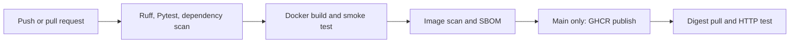
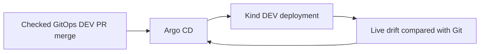

# Aegis CI/CD

A delivery platform built incrementally for learning and a DevOps portfolio.
**Current scope: Phase 5 — protected release promotion in local Kind. DEV and STAGING verified; PROD awaits human review.**

Start with the [release management guide](DOCS/20-release-management-guide.md) and
[Phase 5 evidence report](DOCS/21-phase-5-report.md). Both source and GitOps repositories
are public portfolio repositories; GHCR remains private.

Verified [Phase 2 release](https://github.com/prasanthece42/aegis-cicd/actions/runs/40246584982): scans, GHCR push, and digest-pulled HTTP checks passed.
See the [release report](DOCS/12-phase-2-report.md) for the exact digest and evidence.

## Key features

- FastAPI `/health` endpoint with a typed JSON contract.
- Pytest HTTP contract tests and Ruff lint/format gates.
- Hashed dependency locks and a Python 3.12 non-root container.
- Trivy dependency and image gates block every CRITICAL vulnerability.
- GitHub Actions publishes the validated candidate to GHCR and verifies a digest pull.
- Full reports, CycloneDX SBOM, and unsigned release metadata retain traceability.

Local Kubernetes DEV is now reconciled by Argo CD. Start with the
[Argo CD guide](DOCS/17-argocd-guide.md). The original Kind bootstrap is described in the
[Phase 3 guide](DOCS/14-kubernetes-helm-guide.md); deployment templates live in the
separate [aegis-gitops repository](https://github.com/prasanthece42/aegis-gitops).
Both [application CI/release](https://github.com/prasanthece42/aegis-cicd/actions/runs/40249322983)
and [chart validation](https://github.com/prasanthece42/aegis-gitops/actions/runs/40249510939) passed.

## Delivery flow



## Deployment flow



The local bridge verifies an exact multi-platform OCI bundle and records cache health.
The GitOps workflow opens a DEV PR with its short-lived repository token. Required checks
precede merge and Argo auto-sync. Healthy DEV permits STAGING promotion; healthy STAGING
permits a PROD proposal requiring fresh human review. STAGING/PROD Argo sync is explicit.
The bridge is currently run one shot; unattended background operation awaits approval.

## Project structure

```text
app/                         FastAPI application
tests/                      HTTP contract tests
.github/workflows/ci.yml     PR checks and shared release validation
.github/workflows/release.yml Main-only GHCR publication
scripts/                     Setup, CI, container, and local Kubernetes commands
kind/                        Pinned local cluster configuration
DOCS/                        Numbered learning and operational guides
ARCHITECTURE.md              Current and target delivery architecture
Dockerfile                   Multi-stage runtime image
pyproject.toml               Python, Ruff, and Pytest configuration
requirements-prod.in         Direct runtime dependency pins
requirements-prod.txt        Runtime dependency lock with hashes
requirements.in              Direct development dependency pins
requirements.txt             Development dependency lock with hashes
```

## Tech stack

| Layer | Technology |
| --- | --- |
| Application | Python 3.12, FastAPI, Uvicorn |
| Quality | Pytest, HTTPX, Ruff |
| Container | Docker, Debian slim, non-root UID 10001 |
| Automation | GitHub Actions |
| Security and registry | Trivy, GHCR |
| Local deployment | Kind, Kubernetes, Helm |
| GitOps reconciliation | Argo CD 3.5.6 |
| Release management | Protected GitOps PRs, digest promotion, health gates |

## Getting started

From this repository directory:

```bash
bash scripts/bootstrap-local.sh
bash scripts/verify-local.sh
venv_dir="${AEGIS_VENV_DIR:-${TMPDIR:-/tmp}/aegis-cicd-venv}"
"$venv_dir/bin/uvicorn" app.main:app --reload --host 127.0.0.1 --port 8000
```

In another terminal:

```bash
curl --fail http://127.0.0.1:8000/health
# {"status":"ok"}
```

Build and verify Docker:

```bash
docker build -t aegis-sample:phase1 .
bash scripts/verify-container.sh aegis-sample:phase1
```

Setup requires Python 3.12 and access to PyPI. Container checks require Docker,
Python 3, and curl. The virtual environment lives outside the repository because
Python venv rejects this workspace's colon-containing path. Override AEGIS_VENV_DIR
with a colon-free absolute path if desired. Re-run bootstrap if temporary files are removed.

## Documentation index

| Guide | What it covers |
| --- | --- |
| [Architecture](ARCHITECTURE.md) | Current scope and future repository boundary |
| [01 — Implementation plan](DOCS/01-implementation-plan.md) | Ordered Phase 1 work |
| [02 — Setup guide](DOCS/02-setup-guide.md) | Local execution and GitHub bootstrap |
| [03 — Pipeline flow](DOCS/03-pipeline-flow.md) | Jobs, permissions, and failures |
| [04 — Configuration guide](DOCS/04-configuration-guide.md) | Every major file explained |
| [05 — Troubleshooting](DOCS/05-troubleshooting.md) | Common failures and recovery |
| [06 — Acceptance checklist](DOCS/06-acceptance-checklist.md) | Verification status |
| [07 — Phase 1 report](DOCS/07-phase-1-report.md) | Commands, results, and limitations |
| [08 — Learning notes](DOCS/08-learning-notes.md) | Enterprise context and interview questions |
| [09 — Phase 2 plan](DOCS/09-phase-2-plan.md) | Scope and acceptance criteria |
| [10 — Security policy](DOCS/10-security-policy.md) | Blocking thresholds and trust boundaries |
| [11 — Release guide](DOCS/11-release-guide.md) | GHCR flow, commands, and learning notes |
| [12 — Phase 2 report](DOCS/12-phase-2-report.md) | Scan results and release evidence |
| [13 — Phase 3 plan](DOCS/13-phase-3-plan.md) | Local Kubernetes architecture and scope |
| [14 — Kubernetes and Helm guide](DOCS/14-kubernetes-helm-guide.md) | Setup, code, commands, troubleshooting, and learning |
| [15 — Phase 3 report](DOCS/15-phase-3-report.md) | Real deployment and recovery evidence |
| [16 — Phase 4 plan](DOCS/16-phase-4-plan.md) | Argo scope and acceptance |
| [17 — Argo CD guide](DOCS/17-argocd-guide.md) | Live flow, code, UI access, security, and learning |
| [18 — Phase 4 report](DOCS/18-phase-4-report.md) | Git-driven sync, self-healing, and revert evidence |
| [19 — Phase 5 plan](DOCS/19-phase-5-plan.md) | Release management acceptance |
| [20 — Release management](DOCS/20-release-management-guide.md) | Multi-platform release, code map, promotion and rollback |
| [21 — Phase 5 report](DOCS/21-phase-5-report.md) | Verified results and pending production review |

Documentation layout adapted from [8hr-MARATHON](https://github.com/d-hackmt/8hr-MARATHON).
Phase 2 releases run on pushes to main. PRs scan and test without publishing.
See the release guide for scan commands and evidence. Local DEV deployment now follows GitOps changes through Argo CD. Workstation
scripts bootstrap Argo; GitHub workflows do not deploy to Kubernetes. No AWS provisioning runs here.
